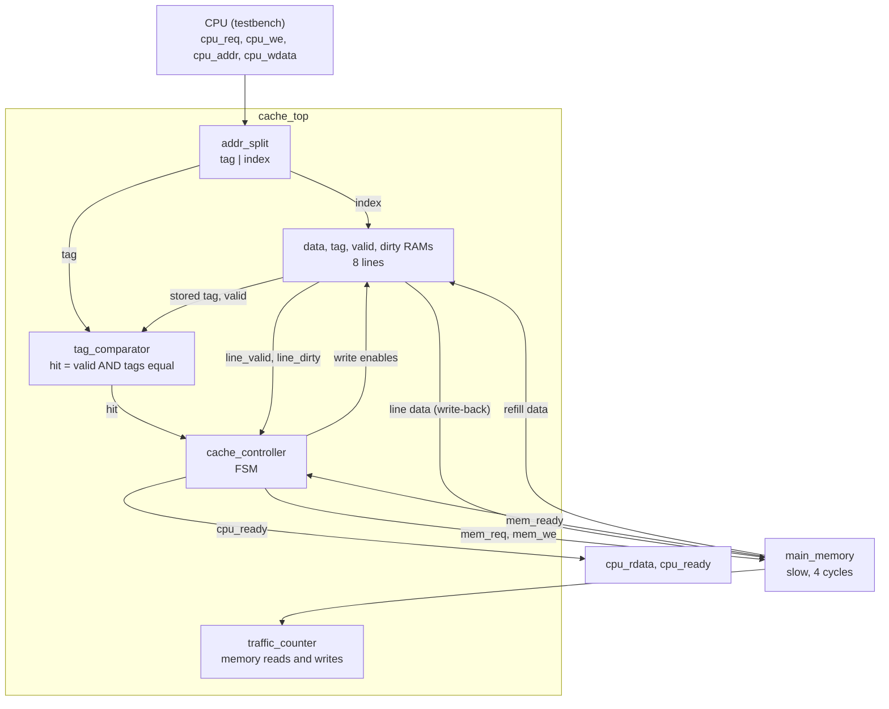

<div align="center">

# Write-Back Cache in Verilog

**A direct-mapped write-back cache with a switchable write-through mode,<br>written in Verilog and verified in simulation.**

[](rtl) [](https://steveicarus.github.io/iverilog/) [](#verification) [](#results)

<br>

[Overview](#overview) &nbsp;·&nbsp; [Architecture](#architecture) &nbsp;·&nbsp; [Operation](#operation) &nbsp;·&nbsp; [Modules](#modules) &nbsp;·&nbsp; [Verification](#verification) &nbsp;·&nbsp; [Results](#results) &nbsp;·&nbsp; [Demo](#demo) &nbsp;·&nbsp; [Getting started](#getting-started) &nbsp;·&nbsp; [Team](#team)

</div>

---

## Overview

This project implements an 8-line, direct-mapped cache in Verilog. The cache sits between a CPU testbench and a slow main-memory model, and handles writes with either a write-back or a write-through policy, selected by an input signal. A controller state machine manages hits, evictions and refills, and counters record the memory reads and writes. The design is verified with a unit test for each module, a system test that runs in both write modes, and a traffic comparison on four workloads.

| Policy | Write hit | Main memory updated |
| --- | --- | --- |
| Write-through | cache and memory | on every write |
| Write-back | cache only, line marked dirty | when the dirty line is evicted |

## Architecture



### Parameters

| Parameter | Value |
| --- | --- |
| Main memory | 256 x 32-bit words, 8-bit word address, 4 cycles per access |
| Cache | direct-mapped, 8 lines, 1 word per line |
| Address split | tag `[7:3]` (5 bits), index `[2:0]` (3 bits), no offset |
| Cache line | valid (1), dirty (1), tag (5), data (32): 39 bits, 312 bits in total |
| Hit | valid AND stored tag equals address tag |
| Write policy | write-back; write-through when `write_through` = 1 |
| Write miss | write-allocate |

Example: address 21 (`00010 101`) maps to line 5 with tag 2.

### Datapath multiplexers

| Multiplexer | Expression | Purpose |
| --- | --- | --- |
| Data RAM input | `data_from_mem ? mem_rdata : cpu_wdata` | refill or write hit |
| Memory address | `mem_we ? {stored_tag, index} : cpu_addr` | write-back or read |

## Operation


| State | Code | Function |
| --- | --- | --- |
| `IDLE` | 0 | wait for a CPU request |
| `COMPARE` | 1 | check for a hit; serve it or choose the miss path |
| `WRITE_BACK` | 2 | write the old dirty word to memory |
| `ALLOCATE` | 3 | read the new word from memory and refill the line |
| `WRITE_MEM` | 4 | write-through only: write memory, then answer the CPU |

Invariants:

1. `WRITE_BACK` always precedes `ALLOCATE`; the refill never overwrites an unsaved dirty word.
2. A refill writes dirty = 0.
3. Only a write hit in write-back mode sets dirty.

### Example: dirty eviction

Addresses 0 and 8 map to line 0 (system tests T3 and T4):

```
T3 write hit
170  CPU WRITE  addr=0 <- 0000aaaa          memory not touched
T4 eviction of line 0
235  MEMORY WRITE addr=0 data=0000aaaa      old dirty word saved first
285  MEMORY READ  addr=8 data=00001008      then the refill
310  CPU READ   addr=8 -> 00001008
```


## Modules

| Module | Path | Test |
| --- | --- | --- |
| `data_ram`, `tag_ram`, `valid_ram`, `dirty_ram` | [`rtl/storage/`](rtl/storage) | `./scripts/run.sh storage` |
| `addr_split`, `tag_comparator`, `traffic_counter` | [`rtl/hit_logic/`](rtl/hit_logic) | `./scripts/run.sh hit` |
| `main_memory` | [`rtl/memory/`](rtl/memory) | `./scripts/run.sh memory` |
| `cache_controller` | [`rtl/controller/`](rtl/controller) | `./scripts/run.sh controller` |
| `cache_top` | [`rtl/top/`](rtl/top) | `./scripts/run.sh system` |

## Verification

| Suite | File | Scope |
| --- | --- | --- |
| Storage | `tb/unit/tb_storage.v` | reset, per-line read and write, line independence |
| Hit logic | `tb/unit/tb_hit_logic.v` | address split, hit decision, counters |
| Main memory | `tb/unit/tb_main_memory.v` | initial contents, 4-cycle latency, ready handshake |
| Controller | `tb/unit/tb_cache_controller.v` | all states, outputs and transitions in both modes |
| System | `tb/system/tb_cache_top.v` | tests T1 to T7 in both modes |

System tests: T1 read miss, T2 read hit, T3 write hit and dirty bit, T4 dirty eviction, T5 evicted value read back, T6 write miss, T7 reset.

| Waveform | Content |
| --- | --- |
| [`member1-storage-wave.png`](docs/results/member1-storage-wave.png) | storage RAMs |
| [`member3-memory-wave.png`](docs/results/member3-memory-wave.png) | main-memory latency and ready pulse |
| [`member4-fsm-wave.png`](docs/results/member4-fsm-wave.png) | controller, dirty read miss |
| [`t2-read-hit.png`](docs/results/t2-read-hit.png) | system, read hit |
| [`t3-write-hit-dirty.png`](docs/results/t3-write-hit-dirty.png) | system, write-back write hit |
| [`t3-write-through.png`](docs/results/t3-write-through.png) | system, write-through write |
| [`t4-dirty-eviction.png`](docs/results/t4-dirty-eviction.png) | system, dirty eviction |

## Results

`./scripts/run.sh traffic` runs four workloads in both modes:

| Workload | Policy | Memory reads | Memory writes | Clock cycles |
| --- | --- | --- | --- | --- |
| W1: 20 writes to one address, then evict | write-back | 2 | **1** | **80** |
| W1: 20 writes to one address, then evict | write-through | 2 | **20** | **175** |
| W2: write 8 lines once each, then evict all | write-back | 16 | 8 | 184 |
| W2: write 8 lines once each, then evict all | write-through | 16 | 8 | 184 |
| W3: read-only (8 addresses, twice) | write-back | 8 | 0 | 96 |
| W3: read-only (8 addresses, twice) | write-through | 8 | 0 | 96 |
| W4: write, rewrite, read 8 lines, then evict | write-back | 16 | 8 | 232 |
| W4: write, rewrite, read 8 lines, then evict | write-through | 16 | 16 | 272 |

- Write-back reduces memory writes and cycles when lines are written repeatedly (W1, W4).
- The policies tie when each line is written once (W2) and on read-only traffic (W3).

Details: [`docs/results/traffic-comparison.md`](docs/results/traffic-comparison.md).

## Demo

`./scripts/demo.sh` replays seven accesses in both write modes and prints, for each access, the tag, line, hit or miss, cycle count, controller path and running memory traffic. It then shows the final cache contents and a bar chart of the traffic comparison.

```
 #  Operation                  Tag Line  Result        Cycles  Path through the controller                 Mem R/W
 4  WRITE addr   1 = 0xAAAA      0    1  HIT                1  COMPARE                                       3 / 0
 6  READ  addr   9               1    1  MISS + evict      12  COMPARE > WRITE_BACK > ALLOCATE > COMPARE     4 / 1
 7  READ  addr   1               0    1  MISS               7  COMPARE > ALLOCATE > COMPARE                  5 / 1
```

Addresses 1 and 9 share line 1. Step 4 writes line 1 in the cache only and marks it dirty. Step 6 evicts it, saving the old word to memory before the refill, and step 7 reads the written value back.

## Getting started

Requires [Icarus Verilog](https://steveicarus.github.io/iverilog/) (`brew install icarus-verilog` on macOS, `sudo apt install iverilog` on Debian or Ubuntu; Git Bash on Windows). The demo also needs Python 3.

```bash
git clone https://github.com/Abhayanthk/writeback-cache-verilog.git
cd writeback-cache-verilog
chmod +x scripts/run.sh
./scripts/run.sh
```

| Command | Runs |
| --- | --- |
| `./scripts/run.sh` | all suites and the traffic comparison |
| `./scripts/run.sh unit` | the four unit tests |
| `./scripts/run.sh storage`, `hit`, `memory`, `controller` | one unit test |
| `./scripts/run.sh system` | the system test in both modes |
| `./scripts/run.sh traffic` | the traffic comparison |
| `./scripts/demo.sh` | the readable demo |

Waveforms are written to `build/*.vcd` and open in any VCD viewer, for example [Surfer](https://surfer-project.org/).

## Repository structure

```
rtl/
  storage/       data, tag, valid and dirty RAMs
  hit_logic/     address split, tag comparator, traffic counter
  memory/        main-memory model
  controller/    cache controller FSM
  top/           cache_top
tb/
  unit/          unit tests
  system/        system test and traffic comparison
scripts/
  run.sh         test runner
  demo.sh        readable demo
  demo/          demo script and its testbench
docs/
  diagrams/      FSM diagram
  results/       waveforms and the traffic comparison
```

## Limitations

- 1-word blocks: no spatial locality; addresses that share a line can evict each other.
- One request at a time; no write buffer.
- Main memory is a fixed-latency model, not a DRAM controller.
- Simulation only; not synthesised.

## Team

| Name | GitHub | Responsibility |
| --- | --- | --- |
| Ashrith | [ashrith-07](https://github.com/ashrith-07) | cache storage |
| Abhayanth | [Abhayanthk](https://github.com/Abhayanthk) | hit logic, traffic counters, comparison |
| Akhil | [akhilnathreddy](https://github.com/akhilnathreddy) | main memory |
| Srijan | [Srijan76-code](https://github.com/Srijan76-code) | controller FSM |
| Aryan | [aryanpatel99](https://github.com/aryanpatel99) | integration, system test, run script |
