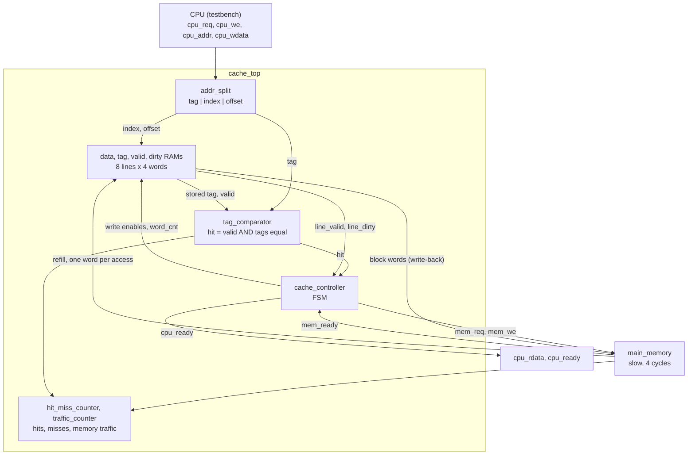
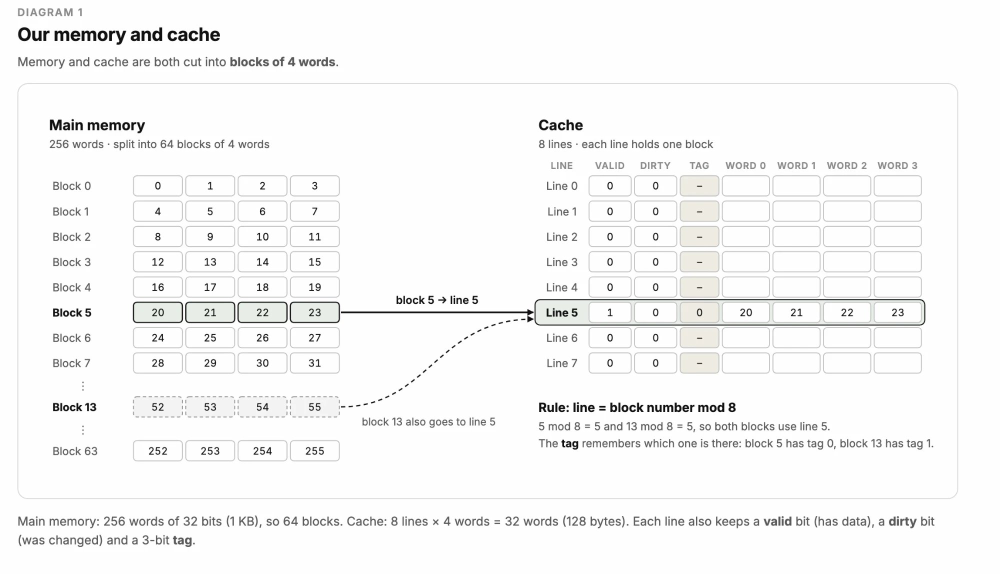
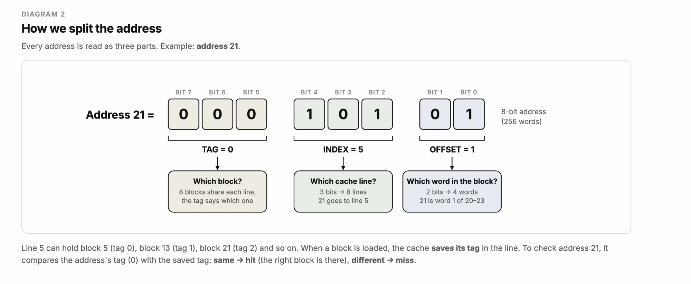
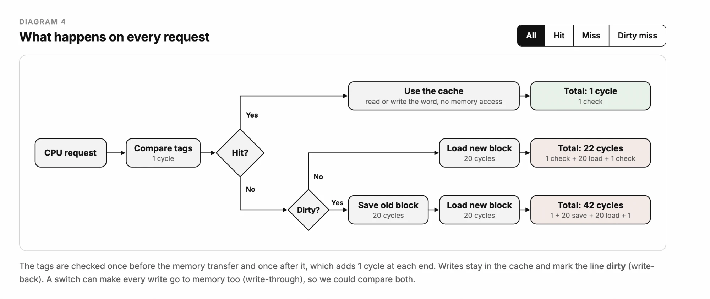
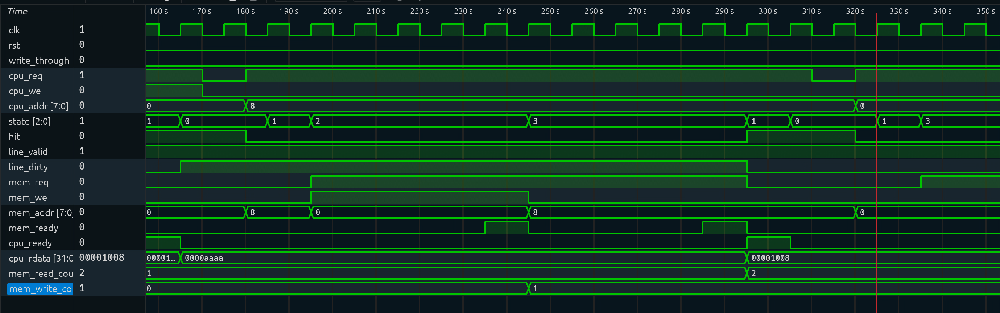

<div align="center">

# Direct-Mapped Cache Controller in Verilog

**A direct-mapped cache controller in Verilog with 8 lines of 16-byte blocks,<br>analysed with memory-access traces for hit rate, miss rate and AMAT, and synthesized for an iCE40 FPGA.**

[](rtl) [](https://steveicarus.github.io/iverilog/) [](#verification) [-75%25-d9730d?style=flat-square)](#hitmiss-analysis) [](#synthesis)

<br>

[Overview](#overview) &nbsp;·&nbsp; [Architecture](#architecture) &nbsp;·&nbsp; [Operation](#operation) &nbsp;·&nbsp; [Modules](#modules) &nbsp;·&nbsp; [Verification](#verification) &nbsp;·&nbsp; [Hit/miss analysis](#hitmiss-analysis) &nbsp;·&nbsp; [Synthesis](#synthesis) &nbsp;·&nbsp; [Demo](#demo) &nbsp;·&nbsp; [Video](https://drive.google.com/drive/folders/1cAgpLGc0a6jVRFi5BkJcIOX9G1jo16D8) &nbsp;·&nbsp; [Slides](docs/presentation/direct-mapped-cache-controller.pdf) &nbsp;·&nbsp; [Live demos](#live-demos) &nbsp;·&nbsp; [Getting started](#getting-started) &nbsp;·&nbsp; [Team](#team)

</div>

---

## Overview

This project implements a direct-mapped cache controller in Verilog (Project 6, Modern Computer Architecture). An 8-line cache with 4-word (16-byte) blocks sits between a CPU testbench and a slow main-memory model. The address is split into tag, index and offset, a tag comparator decides hit or miss, and a controller state machine serves hits and moves whole blocks on misses. Hardware counters record hits, misses and memory traffic. Sequential, repeated, random and conflicting access traces measure the hit rate, miss rate and AMAT, and the design is synthesized for a Lattice iCE40 FPGA. Writes use a write-back policy, with a write-through mode selected by an input signal for comparison.

**Video explanation:** [watch the project walkthrough](https://drive.google.com/drive/folders/1cAgpLGc0a6jVRFi5BkJcIOX9G1jo16D8) (Google Drive).

**Slides:** [`docs/presentation/direct-mapped-cache-controller.pdf`](docs/presentation/direct-mapped-cache-controller.pdf) (7 slides: intro, demo, cache vs no cache, address split, request flow, FSM, results).

### Live demos

Interactive pages shown in the presentation:

- [Live simulator](https://claude.ai/artifact/TCi3FRQm7oqNrGprWGt6Mh): address decoder, request player, trace runner and write-policy race.
- [Access patterns, read by read](https://claude.ai/artifact/KeuJn3pzMwmJ6L6RQCF6Kg): sequential, repeated, random and conflict traces, one read at a time.

| Policy | Write hit | Main memory updated |
| --- | --- | --- |
| Write-through | cache and memory | on every write |
| Write-back | cache only, line marked dirty | when the dirty line is evicted |

## Architecture



### Memory and cache layout



### Parameters

| Parameter | Value |
| --- | --- |
| Main memory | 256 x 32-bit words (1 KB), 8-bit word address, 4 cycles per word |
| Cache | direct-mapped, 8 lines, 4-word (16-byte) blocks, 128 bytes of data |
| Address split | tag `[7:5]` (3 bits), index `[4:2]` (3 bits), offset `[1:0]` (2 bits, word in block) |
| Cache line | valid (1), dirty (1), tag (3), data (4 x 32): 133 bits, 1064 bits in total |
| Hit | valid AND stored tag equals address tag |
| Timing | hit 1 cycle, clean miss 22 cycles, miss penalty 21 cycles |
| Write policy | write-back; write-through when `write_through` = 1 |
| Write miss | write-allocate |

### Address split



### Datapath multiplexers

| Multiplexer | Expression | Purpose |
| --- | --- | --- |
| Word select | `burst ? word_cnt : offset` | block move or CPU access |
| Data RAM input | `data_from_mem ? mem_rdata : cpu_wdata` | refill or write hit |
| Memory address | `mem_we ? {stored_tag, index, word_sel} : {addr_tag, index, word_sel}` | write-back or read, one word at a time |

## Operation

### Request flow



### Controller FSM


| State | Code | Function |
| --- | --- | --- |
| `IDLE` | 0 | wait for a CPU request |
| `COMPARE` | 1 | check for a hit; serve it or choose the miss path |
| `WRITE_BACK` | 2 | write the 4 words of the old dirty block to memory |
| `ALLOCATE` | 3 | read the 4 words of the new block and refill the line |
| `WRITE_MEM` | 4 | write-through only: write memory, then answer the CPU |

Invariants:

1. `WRITE_BACK` always precedes `ALLOCATE`; the refill never overwrites an unsaved dirty block.
2. Tag, valid and dirty = 0 are written only with the last word of a refill.
3. A block move takes 4 memory accesses, counted by `word_cnt`.
4. Only a write hit in write-back mode sets dirty.

### Example: dirty eviction

Addresses 0 and 32 map to line 0 (system tests T3 and T4):

```
T3 write hit
350  CPU WRITE  addr=0 <- 0000aaaa          memory not touched
T4 eviction of line 0
415  MEMORY WRITE addr=0 data=0000aaaa      old dirty block saved first (4 words)
465  MEMORY WRITE addr=1 data=00001001
515  MEMORY WRITE addr=2 data=00001002
565  MEMORY WRITE addr=3 data=00001003
615  MEMORY READ  addr=32 data=00001020     then the refill (4 words)
...
765  MEMORY READ  addr=35 data=00001023
790  CPU READ   addr=32 -> 00001020
```



## Modules

| Module | Path | Test |
| --- | --- | --- |
| `data_ram`, `tag_ram`, `valid_ram`, `dirty_ram` | [`rtl/storage/`](rtl/storage) | `./scripts/run.sh storage` |
| `addr_split` (address decoder), `tag_comparator`, `hit_miss_counter`, `traffic_counter` | [`rtl/hit_logic/`](rtl/hit_logic) | `./scripts/run.sh hit` |
| `main_memory` | [`rtl/memory/`](rtl/memory) | `./scripts/run.sh memory` |
| `cache_controller` | [`rtl/controller/`](rtl/controller) | `./scripts/run.sh controller` |
| `cache_top` | [`rtl/top/`](rtl/top) | `./scripts/run.sh system`, `trace` |
| `cache_core` (synthesis top) | [`syn/`](syn) | `./scripts/synth.sh` |

## Verification

| Suite | File | Scope |
| --- | --- | --- |
| Storage | `tb/unit/tb_storage.v` | reset, per-line and per-word read and write, line and word independence |
| Hit logic | `tb/unit/tb_hit_logic.v` | tag, index and offset split, hit decision on every tag bit, counters |
| Main memory | `tb/unit/tb_main_memory.v` | initial contents, 4-cycle latency, ready handshake |
| Controller | `tb/unit/tb_cache_controller.v` | all states, outputs and transitions in both modes, 4-word block moves |
| System | `tb/system/tb_cache_top.v` | tests T1 to T7 in both modes |
| Trace | `tb/system/tb_trace.v` | 4 traces; every access and the hit/miss counters checked against a reference model; AMAT checked against the formula |

System tests: T1 read miss (whole block read), T2 read hit, T2b hit on the next word of the block, T3 write hit and dirty bit, T4 dirty eviction, T5 evicted value read back, T6 write miss, T7 reset.

| Waveform | Content |
| --- | --- |
| [`member1-storage-wave.png`](docs/results/member1-storage-wave.png) | storage RAMs |
| [`member2-hit-logic-wave.png`](docs/results/member2-hit-logic-wave.png) | address split and tag comparator |
| [`member3-memory-wave.png`](docs/results/member3-memory-wave.png) | main-memory latency and ready pulse |
| [`member4-fsm-wave.png`](docs/results/member4-fsm-wave.png) | controller, dirty read miss |
| [`t2-read-hit.png`](docs/results/t2-read-hit.png) | system, read hit |
| [`t3-write-hit-dirty.png`](docs/results/t3-write-hit-dirty.png) | system, write-back write hit |
| [`t3-write-through.png`](docs/results/t3-write-through.png) | system, write-through write |
| [`t4-dirty-eviction.png`](docs/results/t4-dirty-eviction.png) | system, dirty eviction |

## Hit/miss analysis

`./scripts/run.sh trace` runs four 64-read traces from [`traces/`](traces). AMAT = hit time + miss rate × miss penalty = 1 + miss rate × 21 cycles.

| Trace | Pattern | Hits | Misses | Hit rate | AMAT (cycles) |
| --- | --- | --- | --- | --- | --- |
| sequential | addresses 0 to 63, once each | 48 | 16 | **75.0%** | 6.25 |
| repeated | addresses 0, 4 ... 28 (one per line), looped 8 times | 56 | 8 | **87.5%** | **3.62** |
| random | random reads from addresses 0 to 127 | 18 | 46 | 28.1% | 16.09 |
| conflict | address 1 alternating with 33, 65, 129 (all line 0) | 0 | 64 | 0.0% | 22.00 |

- Sequential: each miss brings in a 4-word block, so the next 3 reads hit (spatial locality).
- Repeated: the 8 addresses fit in the 8 lines, so only the first pass misses (temporal locality).
- Random: the trace covers 4 times the cache capacity, so most blocks are replaced before reuse.
- Conflict: addresses with the same index evict each other while 7 lines stay empty, the main weakness of direct mapping.

Details: [`docs/results/hit-miss-report.md`](docs/results/hit-miss-report.md).

## Synthesis

`./scripts/synth.sh` synthesizes the cache (without the main-memory model) with Yosys and nextpnr for a Lattice iCE40 HX8K.

| Logic cells | LUT4 | Flip-flops | Block RAM | Max frequency |
| --- | --- | --- | --- | --- |
| 2184 / 7680 (28%) | 1132 | 1071 | 0 | **82.87 MHz** |

Details: [`docs/results/synthesis.md`](docs/results/synthesis.md).

## Write-policy comparison

`./scripts/run.sh traffic` runs four workloads in both write modes (memory reads and writes count words):

| Workload | Policy | Memory reads | Memory writes | Clock cycles |
| --- | --- | --- | --- | --- |
| W1: 20 writes to one address, then evict | write-back | 8 | **4** | **125** |
| W1: 20 writes to one address, then evict | write-through | 8 | **20** | **205** |
| W2: write 8 lines once each, then evict all | write-back | 64 | 32 | 544 |
| W2: write 8 lines once each, then evict all | write-through | 64 | 8 | 424 |
| W3: read-only (8 lines, twice) | write-back | 32 | 0 | 216 |
| W3: read-only (8 lines, twice) | write-through | 32 | 0 | 216 |
| W4: write, rewrite, read 8 lines, then evict | write-back | 64 | 32 | 592 |
| W4: write, rewrite, read 8 lines, then evict | write-through | 64 | 16 | 512 |

Write-back saves traffic when one word is written many times (W1). A dirty line writes back its whole 4-word block, so write-through needs fewer writes when each line gets only one or two writes (W2, W4). Details: [`docs/results/traffic-comparison.md`](docs/results/traffic-comparison.md).

## Demo

`./scripts/demo.sh` replays seven accesses in both write modes and prints, for each access, the tag, line, word, hit or miss, cycle count, controller path and running memory traffic. It then shows the final cache contents and a bar chart of the traffic comparison.

```
 #  Operation                  Tag Line Word  Result        Cycles  Path through the controller                 Mem R/W
 2  READ  addr   1               0    0    1  HIT                1  COMPARE                                      4 / 0
 4  WRITE addr   1 = 0xAAAA      0    0    1  HIT                1  COMPARE                                      8 / 0
 6  READ  addr  33               1    0    1  MISS + evict      42  COMPARE > WRITE_BACK > ALLOCATE > COMPARE   12 / 4
 7  READ  addr   1               0    0    1  MISS              22  COMPARE > ALLOCATE > COMPARE                16 / 4
```

Step 2 hits because address 1 arrived with address 0's block. Addresses 1 and 33 share line 0: step 4 writes line 0 in the cache only and marks it dirty, step 6 saves the 4-word block to memory before the refill, and step 7 reads the written value back.

## Getting started

Requires [Icarus Verilog](https://steveicarus.github.io/iverilog/) (`brew install icarus-verilog` on macOS, `sudo apt install iverilog` on Debian or Ubuntu; Git Bash on Windows). The demo and the trace generator need Python 3; synthesis needs Yosys and nextpnr-ice40.

```bash
git clone https://github.com/Abhayanthk/direct-mapped-cache-controller.git
cd direct-mapped-cache-controller
chmod +x scripts/run.sh
./scripts/run.sh
```

| Command | Runs |
| --- | --- |
| `./scripts/run.sh` | all suites, the traffic comparison and the traces |
| `./scripts/run.sh unit` | the four unit tests |
| `./scripts/run.sh storage`, `hit`, `memory`, `controller` | one unit test |
| `./scripts/run.sh system` | the system test in both modes |
| `./scripts/run.sh trace` | the hit/miss and AMAT traces |
| `./scripts/run.sh traffic` | the write-policy comparison |
| `./scripts/synth.sh` | synthesis, resources and max frequency |
| `./scripts/demo.sh` | the readable demo |

Waveforms are written to `build/*.vcd` and open in any VCD viewer, for example [Surfer](https://surfer-project.org/).

## Repository structure

```
rtl/
  storage/       data, tag, valid and dirty RAMs
  hit_logic/     address split, tag comparator, hit/miss and traffic counters
  memory/        main-memory model
  controller/    cache controller FSM
  top/           cache_top
tb/
  unit/          unit tests
  system/        system test, trace test and traffic comparison
traces/          memory-access traces (sequential, repeated, random, conflict)
syn/             synthesis top (cache without the memory model)
scripts/
  run.sh         test runner
  synth.sh       synthesis
  gen_traces.py  trace generator
  demo.sh        readable demo
  demo/          demo script and its testbench
docs/
  diagrams/      FSM diagram (fsm.svg source, fsm.png), memory and cache layout, address split, request flow
  presentation/  presentation slides (PDF)
  results/       waveforms, hit/miss report, synthesis, traffic comparison
```

## Limitations

- One dirty bit per line: a write-back always moves the whole 4-word block, even if one word changed.
- Memory moves one word per access (no burst mode), so a miss costs 4 full memory accesses.
- Direct mapped: addresses that share a line evict each other (conflict trace).
- One request at a time; no write buffer.
- Main memory is a fixed-latency model, not a DRAM controller.
- Synthesized for an FPGA, not yet run on a board.

## Team

| Name | GitHub | Responsibility |
| --- | --- | --- |
| Ashrith | [ashrith-07](https://github.com/ashrith-07) | cache storage |
| Abhayanth | [Abhayanthk](https://github.com/Abhayanthk) | hit logic, hit/miss and traffic counters, traces, AMAT |
| Akhil | [akhilnathreddy](https://github.com/akhilnathreddy) | main memory |
| Srijan | [Srijan76-code](https://github.com/Srijan76-code) | controller FSM |
| Aryan | [aryanpatel99](https://github.com/aryanpatel99) | integration, system test, run script |
