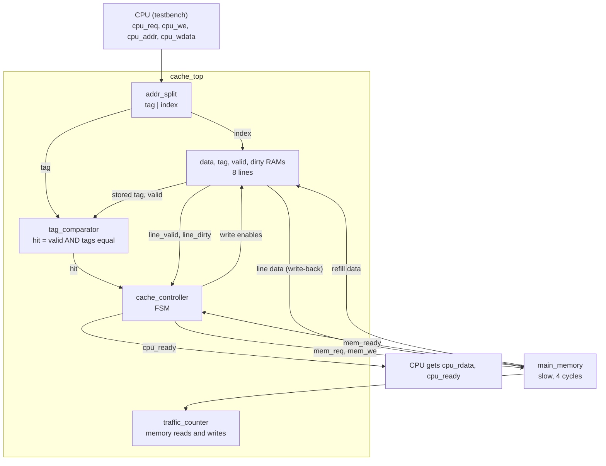
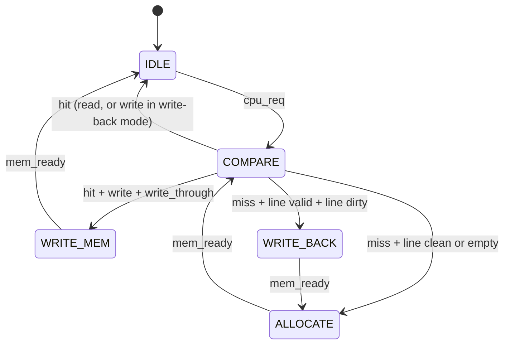

# Write-Back Cache in Verilog

A small **write-back cache** written in Verilog and verified in simulation. It sits between a (testbench) CPU and a slow main-memory model, and it can also run as a **write-through** cache, so the two write policies can be compared on memory traffic.

> MCA course project.

## The idea in 30 seconds

- A **cache** is a small, fast memory between the CPU and the slow main memory. It keeps copies of recently used words, so most accesses never reach main memory.
- **Write-back:** when the CPU writes a word that is in the cache, only the cache changes and the line is marked **dirty**. Main memory gets the new value **later**, only when that line is evicted.
- **Write-through:** every write goes to the cache **and** to main memory at once.
- We prove the design with unit tests, a system test, waveforms, and a **memory-traffic comparison** of the two policies.

| | Write-through | Write-back |
| --- | --- | --- |
| Write hit | cache **and** memory | cache only, set **dirty** |
| Memory consistency | always up to date | memory is stale until eviction |
| Memory writes | one per CPU write | one per dirty line evicted |
| Extra hardware | none | a dirty bit per line |

## Design at a glance

| Item | Value |
| --- | --- |
| Main memory | 256 words x 32 bits, 8-bit word address, **4 clock cycles per access**, `mem[a] = 0x1000 + a` after reset |
| Cache organisation | **direct-mapped**, 8 lines, **1 word per line** |
| Address split | tag = `addr[7:3]` (5 bits), index = `addr[2:0]` (3 bits), offset = 0 bits |
| One cache line | valid (1) + dirty (1) + tag (5) + data (32) = **39 bits**; the whole cache stores 312 bits |
| Write policy | write-back, or write-through when the `write_through` input is 1 |
| Write miss | **write-allocate**: refill the line first, then write |
| Eviction rule | a valid **and** dirty line is written back to memory **before** the refill |

## Architecture



Two multiplexers inside `cache_top`:

| Multiplexer | Rule |
| --- | --- |
| Data RAM input | `data_from_mem ? mem_rdata : cpu_wdata` (memory data on a refill, CPU data on a write hit) |
| Memory address | `mem_we ? {stored_tag, index} : cpu_addr` (a write-back saves the **old** word to its **old** address) |

## How an address is used

The 8-bit address is cut into a tag and an index. The index picks the cache line, and the tag says which memory block is in that line right now.

```
 7 6 5 4 3 | 2 1 0
   tag     | index
```

Example: address **21** = `00010 101`, so **tag 2, line 5**. Addresses 5, 13, 21, 29, ... (same last three bits) all compete for line 5, which is why the tag is stored.

**Hit** = the line is **valid** AND the stored tag equals the address tag.

## The controller (FSM)


| State | Number | What it does |
| --- | --- | --- |
| IDLE | 0 | wait for a CPU request |
| COMPARE | 1 | check hit; serve a hit, or decide which miss path to take |
| WRITE_BACK | 2 | write the old dirty word to memory |
| ALLOCATE | 3 | read the new word from memory and refill the line |
| WRITE_MEM | 4 | write-through only: write memory, then answer the CPU |



Three rules that matter:

1. **Write back before refill.** WRITE_BACK always goes to ALLOCATE, never the other way, or the old dirty data would be overwritten and lost.
2. **A refill makes the line clean** (dirty is written as 0).
3. **Only a write hit in write-back mode sets dirty.** Write-through never sets it.

After ALLOCATE the FSM goes back to COMPARE, which now sees a hit and serves the request with the normal hit path.

## Walkthrough: a dirty eviction

Addresses 0 and 8 share line 0 (tags 0 and 1). This is the real simulation log of tests T3 and T4:

```
T3 write hit
170  CPU WRITE  addr=0 <- 0000aaaa          (no MEMORY line: memory is not touched)
T4 eviction of line 0
235  MEMORY WRITE addr=0 data=0000aaaa      <- the old dirty word is saved first
285  MEMORY READ  addr=8 data=00001008      <- then the new block is refilled
310  CPU READ   addr=8 -> 00001008
```


The waveform shows the state path COMPARE (1), WRITE_BACK (2), ALLOCATE (3), COMPARE (1), with `mem_addr` equal to 0 during the write-back and 8 during the refill.

## Results: memory traffic

The same workloads run in both modes (`./scripts/run.sh traffic`):

| Workload | Policy | Memory reads | Memory writes | Clock cycles |
| --- | --- | --- | --- | --- |
| W1: 20 writes to one address, then evict | write-back | 2 | **1** | **80** |
| W1: 20 writes to one address, then evict | write-through | 2 | **20** | **175** |
| W2: write 8 lines once each, then evict all | write-back | 16 | 8 | 184 |
| W2: write 8 lines once each, then evict all | write-through | 16 | 8 | 184 |
| W3: read-only (8 addresses, twice) | write-back | 8 | 0 | 96 |
| W3: read-only (8 addresses, twice) | write-through | 8 | 0 | 96 |
| W4: loop-like, rewrite, then evict | write-back | 16 | 8 | 232 |
| W4: loop-like, rewrite, then evict | write-through | 16 | 16 | 272 |

The full table and explanation are in [`docs/results/traffic-comparison.md`](docs/results/traffic-comparison.md).

- **Write-back wins** when the same line is written many times (W1, W4): fewer memory writes, so fewer cycles.
- **They tie** when each line is written once (W2), because every dirty line still has to be written back once.
- **Reads are the same** (W3): the policy only affects writes.

## Waveforms

| Picture | What it shows |
| --- | --- |
| `docs/results/member1-storage-wave.png` | the storage RAMs: data changes only after a clock edge while write enable is 1 |
| `docs/results/member3-memory-wave.png` | main memory: `wait_count` 0, 1, 2, 3, then a one-cycle `mem_ready` |
| `docs/results/member4-fsm-wave.png` | controller: COMPARE, WRITE_BACK, ALLOCATE, COMPARE on a dirty miss |
| `docs/results/t2-read-hit.png` | read hit: no memory request |
| `docs/results/t3-write-hit-dirty.png` | write hit in write-back mode: dirty goes 0 to 1, memory untouched |
| `docs/results/t4-dirty-eviction.png` | dirty eviction: write-back, then refill |
| `docs/results/t3-write-through.png` | write-through: the memory write happens immediately |

## Parts, files and tests

| Part | Files | What it does | Test | Owner |
| --- | --- | --- | --- | --- |
| Storage | `rtl/storage/` (`data_ram.v`, `tag_ram.v`, `valid_ram.v`, `dirty_ram.v`) | one entry per cache line: data, tag, valid, dirty | `./scripts/run.sh storage` | Ashrith ([ashrith-07](https://github.com/ashrith-07)) |
| Hit logic | `rtl/hit_logic/` (`addr_split.v`, `tag_comparator.v`, `traffic_counter.v`) | split the address, decide hit or miss, count memory reads and writes | `./scripts/run.sh hit` | Abhayanth ([Abhayanthk](https://github.com/Abhayanthk)) |
| Main memory | `rtl/memory/main_memory.v` | slow memory, 4 cycles, request and ready handshake | `./scripts/run.sh memory` | Akhil ([akhilnathreddy](https://github.com/akhilnathreddy)) |
| Controller | `rtl/controller/cache_controller.v`, `docs/diagrams/fsm.png` | the FSM: hits, dirty write-back, refill, write-through | `./scripts/run.sh controller` | Srijan ([Srijan76-code](https://github.com/Srijan76-code)) |
| Top and system test | `rtl/top/cache_top.v`, `tb/system/tb_cache_top.v`, `scripts/run.sh` | joins all parts, system test T1 to T7 in both modes | `./scripts/run.sh system` | Aryan ([aryanpatel99](https://github.com/aryanpatel99)) |
| Traffic comparison | `tb/system/tb_traffic.v` | the same workloads under both policies | `./scripts/run.sh traffic` | Abhayanth |

The system test checks, in both modes: T1 read miss, T2 read hit, T3 write hit (and the dirty bit), T4 dirty eviction, T5 the written value survives the round trip, T6 write miss, T7 reset empties the cache.

## Repository layout

```
rtl/
  storage/      data, tag, valid and dirty RAMs
  hit_logic/    address split, tag comparator, traffic counter
  memory/       slow main-memory model
  controller/   cache controller FSM
  top/          cache_top (joins everything)
tb/
  unit/         one unit test per part
  system/       system test and the traffic comparison
scripts/        run.sh
docs/
  diagrams/     FSM diagram
  results/      waveform pictures
```

## Run it yourself

You need [Icarus Verilog](https://steveicarus.github.io/iverilog/) (`iverilog` and `vvp`). On macOS: `brew install icarus-verilog`. On Windows, run the commands inside Git Bash.

```bash
git clone https://github.com/Abhayanthk/writeback-cache-verilog.git
cd writeback-cache-verilog
chmod +x scripts/run.sh
./scripts/run.sh
```

| Command | Runs |
| --- | --- |
| `./scripts/run.sh` | everything below |
| `./scripts/run.sh unit` | the four unit tests |
| `./scripts/run.sh storage` / `hit` / `memory` / `controller` | one unit test |
| `./scripts/run.sh system` | the full cache, seven tests in both modes |
| `./scripts/run.sh traffic` | the write-back vs write-through table |

A successful run prints `ALL STORAGE TESTS PASSED`, `ALL HIT-LOGIC TESTS PASSED`, `ALL MAIN-MEMORY TESTS PASSED`, `ALL CONTROLLER TESTS PASSED` and `ALL SYSTEM TESTS PASSED`, then the results table. Waveform files are written to `build/*.vcd` and can be opened in any VCD viewer such as [Surfer](https://surfer-project.org/).

Reading the log of the system test: `MEMORY READ` means a miss was refilled, `MEMORY WRITE` in write-back mode means a dirty line was evicted, and a `CPU READ` with no `MEMORY` line before it is a hit.

## Simplifications

- Direct-mapped with **1-word blocks**, so there is no spatial-locality benefit and conflict misses are possible (addresses with the same last three bits share a line).
- One request at a time, and no write buffer.
- Main memory is a simulation model (256 words, fixed 4-cycle latency), not a real DRAM controller.
- Verified in simulation only, with no FPGA board.

## Team

| Name | GitHub | Part |
| --- | --- | --- |
| Ashrith | [ashrith-07](https://github.com/ashrith-07) | Cache storage |
| Abhayanth | [Abhayanthk](https://github.com/Abhayanthk) | Hit logic, traffic counters, comparison |
| Akhil | [akhilnathreddy](https://github.com/akhilnathreddy) | Main memory |
| Srijan | [Srijan76-code](https://github.com/Srijan76-code) | Controller FSM |
| Aryan | [aryanpatel99](https://github.com/aryanpatel99) | Integration and system test |
