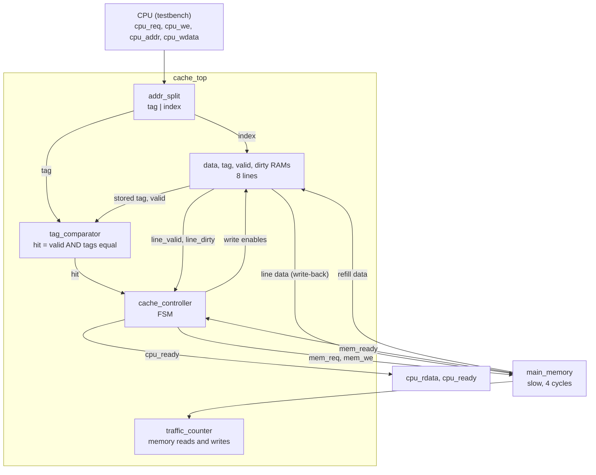
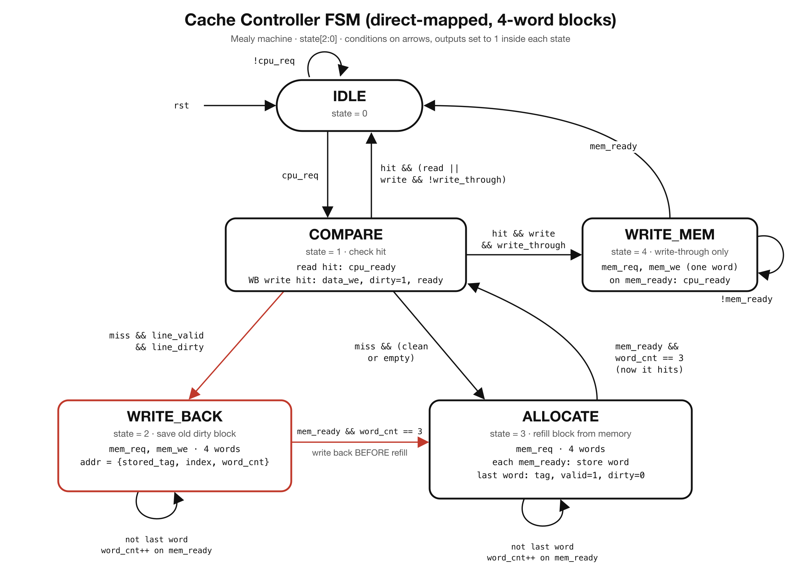

<div align="center">

# Write-Back Cache in Verilog

**A direct-mapped write-back cache with a switchable write-through mode,<br>written in Verilog and verified in simulation.**

[](rtl) [](https://steveicarus.github.io/iverilog/) [](#verification) [](#results)

<br>

[Overview](#overview) &nbsp;·&nbsp; [Architecture](#architecture) &nbsp;·&nbsp; [Operation](#operation) &nbsp;·&nbsp; [Modules](#modules) &nbsp;·&nbsp; [Verification](#verification) &nbsp;·&nbsp; [Results](#results) &nbsp;·&nbsp; [Getting started](#getting-started) &nbsp;·&nbsp; [Team](#team)

</div>

---

## Overview

A cache is a small, fast memory that keeps copies of recently used words, so most CPU accesses never reach the slow main memory. This cache supports two ways of handling writes, and the project compares them on main-memory traffic:

| Policy | What a write does | Main memory is updated | Extra storage |
| --- | --- | --- | --- |
| Write-through | changes the cache and main memory together | on every write | none |
| Write-back | changes only the cache and marks the line **dirty** | later, when the dirty line is evicted | 1 dirty bit per line |

A line is **dirty** when the cache holds a newer value than main memory. **Evicting** a line means removing it to make room for another.

Every module has its own unit test, a system test runs the whole cache in both write modes, and a traffic comparison measures four workloads.

## Architecture



### Design parameters

| Parameter | Value |
| --- | --- |
| Main memory | 256 words x 32 bits, 8-bit word address, 4 clock cycles per access |
| Cache organisation | direct-mapped (each address has exactly one possible line), 8 lines, 1 word per line |
| Write policy | write-back, or write-through when the `write_through` input is 1 |
| Write miss | load the line from memory first, then write to it (write-allocate) |

### Address mapping

The 8-bit address is split into a tag and an index. The index selects the cache line, and the tag says which memory address currently occupies that line.

```
 bit:  7 6 5 4 3 | 2 1 0
       tag [7:3] | index [2:0]
```

For example, address 21 is `00010 101`, so it maps to **line 5** with **tag 2**. Every address whose last three bits are `101` uses line 5, so each line stores a tag to know which one it holds.

### Cache line

| Field | Bits | Meaning |
| --- | --- | --- |
| valid | 1 | the line holds real data (0 after reset) |
| dirty | 1 | the line was written and main memory is out of date |
| tag | 5 | which address the line holds |
| data | 32 | one word |

Each line is 39 bits, so the 8 lines store 312 bits. A **hit** happens when the line is valid **and** its stored tag equals the address tag.

### Datapath multiplexers

| Multiplexer | What it chooses |
| --- | --- |
| Data RAM input | the CPU word on a write hit, or the memory word on a refill: `data_from_mem ? mem_rdata : cpu_wdata` |
| Memory address | the CPU address for a read, or the old line's address `{stored_tag, index}` for a write-back: `mem_we ? {stored_tag, index} : cpu_addr` |

## Operation

The controller is a finite state machine (FSM). Every cycle it decides whether to serve a hit, write back a dirty line, or refill from memory.



| State | Code | Function |
| --- | --- | --- |
| `IDLE` | 0 | wait for a CPU request |
| `COMPARE` | 1 | check for a hit, serve it, or choose the miss path |
| `WRITE_BACK` | 2 | write the old dirty word to memory |
| `ALLOCATE` | 3 | read the new word from memory and refill the line |
| `WRITE_MEM` | 4 | write-through only: write memory, then answer the CPU |

Three rules define correct behaviour:

1. **Write back before refill.** `WRITE_BACK` always leads to `ALLOCATE`. In the reverse order the refill would overwrite the dirty word and the CPU's write would be lost.
2. **A refill makes the line clean.** The dirty bit is written as 0 when `ALLOCATE` completes.
3. **Only a write hit in write-back mode sets the dirty bit.** Write-through never does.

After `ALLOCATE` the FSM goes back to `COMPARE`, which now finds a hit and serves the request normally.

### Worked example: dirty eviction

Addresses 0 and 8 share line 0. The log below comes from the system test (tests T3 and T4):

```
T3 write hit
170  CPU WRITE  addr=0 <- 0000aaaa          memory not touched
T4 eviction of line 0
235  MEMORY WRITE addr=0 data=0000aaaa      old dirty word saved first
285  MEMORY READ  addr=8 data=00001008      then the refill
310  CPU READ   addr=8 -> 00001008
```


In the waveform the state goes `COMPARE`, `WRITE_BACK`, `ALLOCATE`, `COMPARE` (codes 1, 2, 3, 1). `mem_addr` is 0 during the write-back and 8 during the refill.

## Modules

| Module | File | Function | Test command |
| --- | --- | --- | --- |
| `data_ram`, `tag_ram`, `valid_ram`, `dirty_ram` | [`rtl/storage/`](rtl/storage) | one entry per cache line; reads are instant, writes happen on the clock edge | `./scripts/run.sh storage` |
| `addr_split`, `tag_comparator`, `traffic_counter` | [`rtl/hit_logic/`](rtl/hit_logic) | split the address, decide hit or miss, count memory reads and writes | `./scripts/run.sh hit` |
| `main_memory` | [`rtl/memory/`](rtl/memory) | slow memory with a request and ready handshake | `./scripts/run.sh memory` |
| `cache_controller` | [`rtl/controller/`](rtl/controller) | the controller FSM | `./scripts/run.sh controller` |
| `cache_top` | [`rtl/top/`](rtl/top) | connects all modules | `./scripts/run.sh system` |

## Verification

| Suite | Location | Checks |
| --- | --- | --- |
| Storage | `tb/unit/tb_storage.v` | reset, write and read per line, write enable, writing one line leaves the others unchanged |
| Hit logic | `tb/unit/tb_hit_logic.v` | address split, hit and miss decisions, counters |
| Main memory | `tb/unit/tb_main_memory.v` | initial contents, 4-cycle read and write latency, ready drops after each access, back-to-back accesses |
| Controller | `tb/unit/tb_cache_controller.v` | all five states with their outputs and transitions, in both write modes |
| System | `tb/system/tb_cache_top.v` | seven tests (below), run in both write modes |

System tests: **T1** read miss, **T2** read hit, **T3** write hit and dirty bit, **T4** dirty eviction, **T5** the written value survives the round trip, **T6** write miss, **T7** reset empties the cache.

### Waveforms

| Figure | Shows |
| --- | --- |
| [`member1-storage-wave.png`](docs/results/member1-storage-wave.png) | storage: data changes only after a clock edge while write enable is 1 |
| [`member3-memory-wave.png`](docs/results/member3-memory-wave.png) | main memory: `wait_count` 0 to 3, then a one-cycle `mem_ready` |
| [`member4-fsm-wave.png`](docs/results/member4-fsm-wave.png) | controller: dirty read miss, `COMPARE` to `WRITE_BACK` to `ALLOCATE` |
| [`t2-read-hit.png`](docs/results/t2-read-hit.png) | system, read hit: no memory request |
| [`t3-write-hit-dirty.png`](docs/results/t3-write-hit-dirty.png) | system, write-back write hit: dirty goes 0 to 1, memory untouched |
| [`t3-write-through.png`](docs/results/t3-write-through.png) | system, write-through: the memory write happens immediately |

## Results

Four workloads were run in both write modes (`./scripts/run.sh traffic`):

| Workload | Policy | Memory reads | Memory writes | Clock cycles |
| --- | --- | --- | --- | --- |
| W1: 20 writes to one address, then evict | write-back | 2 | **1** | **80** |
| W1: 20 writes to one address, then evict | write-through | 2 | **20** | **175** |
| W2: write 8 lines once each, then evict all | write-back | 16 | 8 | 184 |
| W2: write 8 lines once each, then evict all | write-through | 16 | 8 | 184 |
| W3: read-only (8 addresses, twice) | write-back | 8 | 0 | 96 |
| W3: read-only (8 addresses, twice) | write-through | 8 | 0 | 96 |
| W4: write, rewrite, read 8 lines, then evict | write-back | 16 | 8 | 232 |
| W4: write, rewrite, read 8 lines, then evict | write-through | 16 | 16 | 272 |

- Write-back wins when a line is written repeatedly (W1, W4): fewer memory writes and fewer cycles.
- They tie when each line is written once (W2), because every dirty line must still be written back once.
- Reads give identical results (W3), since the policies differ only on writes.

The full explanation is in [`docs/results/traffic-comparison.md`](docs/results/traffic-comparison.md).

## Getting started

Requires [Icarus Verilog](https://steveicarus.github.io/iverilog/) (`iverilog` and `vvp`): `brew install icarus-verilog` on macOS, `sudo apt install iverilog` on Debian or Ubuntu. On Windows, install it from the project site and run the commands in Git Bash.

```bash
git clone https://github.com/Abhayanthk/writeback-cache-verilog.git
cd writeback-cache-verilog
chmod +x scripts/run.sh
./scripts/run.sh
```

| Command | Runs |
| --- | --- |
| `./scripts/run.sh` | all suites and the traffic comparison |
| `./scripts/run.sh unit` | the four unit tests |
| `./scripts/run.sh storage`, `hit`, `memory`, `controller` | one unit test |
| `./scripts/run.sh system` | the system test in both modes |
| `./scripts/run.sh traffic` | the write-back vs write-through table |

A successful run prints `ALL ... TESTS PASSED` for each suite. Waveforms are saved in `build/*.vcd`; open them in any VCD viewer, for example [Surfer](https://surfer-project.org/).

Reading the system-test log:

- `MEMORY READ` is a refill after a miss.
- `MEMORY WRITE` in write-back mode is a dirty eviction.
- A `CPU READ` with no `MEMORY` line before it is a hit.

## Repository structure

```
rtl/
  storage/       data, tag, valid and dirty RAMs
  hit_logic/     address split, tag comparator, traffic counter
  memory/        main-memory model
  controller/    cache controller FSM
  top/           cache_top
tb/
  unit/          one unit test per module group
  system/        system test and traffic comparison
scripts/         run.sh
docs/
  diagrams/      FSM diagram
  results/       waveforms and the traffic comparison
```

## Limitations

- Blocks hold 1 word, so nearby addresses give no benefit, and addresses that share a line can evict each other (conflict misses).
- One request is handled at a time, with no write buffer.
- Main memory is a simulation model with a fixed 4-cycle delay, not a real DRAM controller.
- Tested in simulation only, not on an FPGA board.

## Team

| Name | GitHub | Responsibility |
| --- | --- | --- |
| Ashrith | [ashrith-07](https://github.com/ashrith-07) | cache storage |
| Abhayanth | [Abhayanthk](https://github.com/Abhayanthk) | hit logic, traffic counters, comparison |
| Akhil | [akhilnathreddy](https://github.com/akhilnathreddy) | main memory |
| Srijan | [Srijan76-code](https://github.com/Srijan76-code) | controller FSM |
| Aryan | [aryanpatel99](https://github.com/aryanpatel99) | integration, system test, run script |
